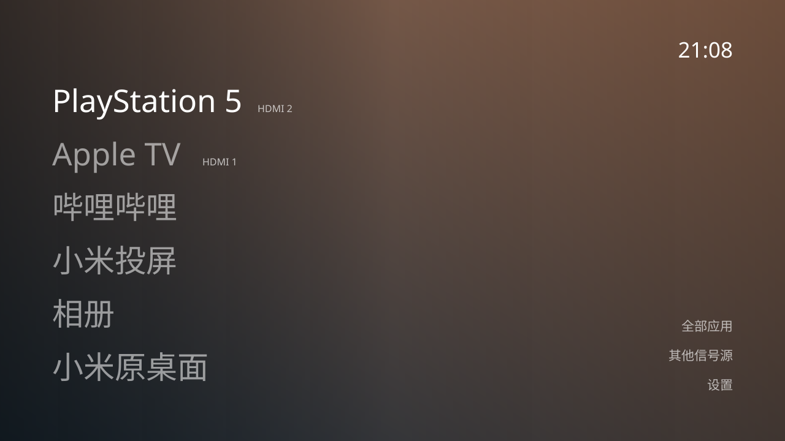

# 归藏电视 TCL 版 · GuiZang TV TCL

保留 [归藏电视](https://github.com/op7418/guizang-tv) 的壁纸、大字列表和毛玻璃 Dock，把 TCL 安装、开机守护和多品牌安装经验整理成一个能交给 AI 执行的分发包。



**[TCL APK](packages/guizang-tv-tcl-0.4.0.apk)** · **[标准 Android TV APK](packages/guizang-tv-standard-0.4.0.apk)** · **[安装技能](skills/guizang-tv-install/SKILL.md)** · [兼容范围](docs/COMPATIBILITY.md) · [影视安装包](packages/README.md)

基于上游 **v0.3.0 / 2c51b09**。本仓库是社区适配分支，保留原作者和 MIT 署名；不是上游官方发布。界面设计和已有设置继续沿用，不包含上游较新 main 的 Codex 对话功能。

## 最省事的用法：把仓库交给 AI

将下面这段发给有终端权限的 Codex、Claude Code 或同类 Agent：

> 请克隆 https://github.com/guozhuangchao-hub/GUIZANGTV-TCL.git，先读 AGENTS.md 和 skills/guizang-tv-install/SKILL.md，帮我在自己的电视安装归藏。检测我的型号、Android版本、CPU架构和现有安装后再选包；不要自动卸载旧应用或禁用原桌面。我希望同时安装附带的新喵影视和TVBox，并保留我的账号和已有设置。需要我操作ADB授权或电视安装同意时，直接告诉我做什么。开机守护和额外权限先说明；最后分别验证桌面、遥控器、信号源、开机/待机和实际播放，不把安装成功等同于所有源可用。

电脑与电视在同一局域网。首次 ADB 授权、多屏互动安装确认仍需在电视上选择“允许/同意”。安装后桌面、守护及本地 TVBox 配置**不需要电脑常开**。

## TCL 有什么不同

- **TCL 包不声明 HOME**，避开部分国行固件对第三方桌面的安装拒绝。
- 遇到 `INSTALL_FAILED_VERIFICATION_FAILURE`，走电视自带**多屏互动**推送；不关闭 APK 验证器、不 root、不删系统桌面。
- `APP_AUTO_START` **和** `APP_ASSOC_START` 配套放行，按需授予悬浮窗及桌面守护权限。
- 可选守护在系统主页出现时回到归藏；回到系统主页、从信号源面板返回和重启是不同路径。主动打开原桌面仍可用。
- 保留照片、字体、列表/Dock、首页排序等偏好。两个影视应用安装后可追加首页，不覆盖原顺序。

这些经验来自 TCL85J8L / Android11 的实际适配，以及 [Tigris](https://github.com/lesnolie/Tigris)/[Aerial](https://github.com/pengchujin/aerial-tv)。其他TCL固件不一定有相同服务；完整边界见兼容表。

## 其他品牌也能尝试

| 设备 | 选包/路径 |
|---|---|
| TCL / 雷鸟国行 | TCL 包，多屏互动或电视本地安装 |
| Sony / Google TV / 标准 Android TV / 盒子 | 标准包，先普通应用，再按需求选择系统默认桌面 |
| 小米 / 红米 | 保留原桌面；已知小米型号接口与普通系统接口分开，系统忽略 Home 选择时按需守护 |
| 创维 / 酷开 | 标准输入框架优先，检测到可用系统选择器时回退；尚未实机验收 |
| 海信及其他 Android 品牌 | 按能力检测，安装/HDMI/Home/待机分别验证；不假设固件接受全部权限 |

最低 **Android8 / API26**。这不是非 Android 的 VIDAA、webOS 或 Tizen 安装包，也不保证所有安卓固件都允许换桌面。标准版声明 HOME，TCL 版不声明；两者包名相同，同签名可覆盖，但不能同时安装为两个应用。

## 手动运行安装工具

需要 Python3.9+ 和官方 Android Platform Tools。以下 `SERIAL` / `TV_PRIVATE_IPV4` 均替换为自己的设备，不照抄开发者家庭地址。

```sh
git clone https://github.com/guozhuangchao-hub/GUIZANGTV-TCL.git
cd GUIZANGTV-TCL
python3 tools/check_packages.py
adb connect TV_PRIVATE_IPV4:PORT
adb devices -l
python3 tools/tv_setup.py doctor --serial SERIAL
python3 tools/tv_setup.py install --serial SERIAL --with-media
```

最后一条默认只打印计划。确认目标和安装内容后：

```sh
python3 tools/tv_setup.py install --serial SERIAL --tv-ip TV_PRIVATE_IPV4 \
  --with-media --backup /PRIVATE/PATH/guizang-before.json --apply
```

标准 Android 安装不需要 `--tv-ip`。TCL 多屏互动需电视的局域网 IPv4；电视上出现“正在发起应用推送”后选择同意。每次只临时提供当前APK，传完即关闭，不暴露整个下载文件夹。

如果希望开机进入、Home键回归藏，先了解[守护权限和恢复](docs/BOOT-START.md)，在上面命令加 `--guard`。普通安装不默认开守护或更改默认桌面。重启/电源键测试另行与电视使用者确认。

旧版本签名不同会导致覆盖安装失败。**不要为了升级自动卸载**：原签名构建或明确迁移设置后再处理。本仓库公开包使用新的社区签名，不等于上游签名或个人试用签名。

## 新喵与 TVBox

`packages/` 携带新喵1.1.2和 TVBox32位原始APK，未重签、未注入账号。`--with-media` 安装并添加首页入口。包来源、SHA256、架构、许可证与 TVBox对应源码见 [安装包说明](packages/README.md)。64位芯片不代表系统支持arm64应用，安装前必须看abilist；本仓库附带的影视包需要v7a支持。

TVBox附带 jinenge 的有效42站源配置和解析插件，可复制到电视本地：

```sh
python3 tools/configure_tvbox.py --serial SERIAL
python3 tools/configure_tvbox.py --serial SERIAL \
  --backup /PRIVATE/PATH/tvbox-before.json --apply
```

已有源时不覆盖，只有用户明确替换时使用 `--replace-source`。软件内置源会过期：本次记录中有直播地址返回605，不能承诺全部可播；新喵与TVBox也不是免费影视内容的保证。界面/API版本不同则由AI看实际页面继续，不能盲点。

## 我们怎么解决适配中的坑

[工具与技能说明](skills/guizang-tv-install/references/toolbox.md) 记录了实际用途：ADB读取前台与提取正确APK；REA逆向确认TCL导出的系统入口；Tigris/Aerial提供守护与多屏互动；百度网盘作为用户手工安装回退；skill-installer定位正确技能目录；Android构建工具验证签名与架构。**普通用户安装不需要同时安装全部技能。**

## 开发与验证

JDK17+、Gradle8.9、Android SDK34（离线构建亦可使用已安装较新SDK）。

```sh
gradle :app:assembleTclDebug :app:assembleStandardDebug \
  :app:testTclDebugUnitTest :app:testStandardDebugUnitTest :app:lintTclDebug :app:lintStandardDebug
python3 -m unittest discover -s tests -v
python3 tools/check_packages.py
```

没有Gradle时可用 `scripts/build_local.py --help`，它调用已安装SDK的aapt2/javac/d8/zipalign/apksigner，签名密钥必须在仓库外。照片处理仍见 [壁纸说明](docs/WALLPAPERS.md)。

本次发布准备没有连接用户电视。新0.4.0包完成离线构建与协议/安装器测试；真实机型记录与新包未实测项见 [验证记录](docs/changes/2026-10-23-tcl-fork.md)。

## 来源与许可

归藏设计/原生实现来自 [op7418/guizang-tv](https://github.com/op7418/guizang-tv)，其初始来源为 cleanYourTV，设计参考 CleanFrame。Tigris/Aerial 的守护与推送经验已保留署名。根 MIT 只覆盖本项目相应代码，第三方APK、源码、内容源及照片遵循各自条件；详见 [NOTICE](NOTICE.md) 和 [packages](packages/README.md)。
